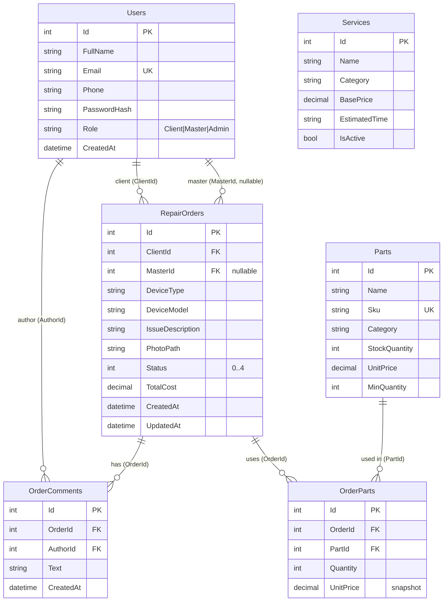

# База данных — «Ремонтная мастерская»

## СУБД
По умолчанию backend использует **SQLite** (`backend/RepairWorkshop.Api/repair_workshop.db`, создаётся автоматически при первом запуске через `EnsureCreated()` + seeder).  
Схема совместима с переносом в PostgreSQL/MS SQL Server при минимальных правках типов (`TEXT` дат → `timestamp`, `INTEGER` PK → identity/serial, `NUMERIC` аналогично).

## ER-диаграмма (логическая модель)

## Таблицы и связи

| Таблица | Назначение | Ключевые связи/ограничения |
|---|---|---|
| `Users` | Клиенты, мастера, администраторы | `Email` UNIQUE; `Role` ∈ {Client, Master, Admin} |
| `Services` | Каталог услуг и ориентировочных цен | `IsActive` для скрытия услуг |
| `Parts` | Склад запчастей | `Sku` UNIQUE; `StockQuantity >= 0` |
| `RepairOrders` | Заявки на ремонт | `ClientId → Users` (RESTRICT), `MasterId → Users` (SET NULL), `Status` 0–4 |
| `OrderComments` | Комментарии мастера/админа по заявке | `OrderId → RepairOrders` (CASCADE), `AuthorId → Users` (RESTRICT) |
| `OrderParts` | Использованные запчасти в заявке | `OrderId → RepairOrders` (CASCADE), `PartId → Parts` (RESTRICT), `UnitPrice` — снимок цены на момент списания |

## Статусы заявки (`RepairOrders.Status`)
| Код | Значение |
|---:|---|
| 0 | Принята |
| 1 | В диагностике |
| 2 | В ремонте |
| 3 | Готова к выдаче |
| 4 | Выдана |

## Файлы
- `schema.sql` — DDL (таблицы, внешние ключи, индексы).
- `seed.sql` — справочные/демо-данные (услуги, запчасти, пример заявок).  
  *Примечание:* пароли в `seed.sql` помечены placeholder’ом; реальные BCrypt-хэши создаёт `DbSeeder` backend’а при первом запуске.

## Целостность и безопасность (на уровне БД/приложения)
- Внешние ключи и проверки (`CHECK`) обеспечивают ссылочную и доменную целостность.
- Уникальные индексы: `Users.Email`, `Parts.Sku`.
- Пароли хранятся как BCrypt-хэши (в приложении), не в открытом виде.
- Доступ к данным разграничен ролями на уровне API; SQL-запросы выполняются через параметризованный EF Core (защита от SQL-инъекций).
